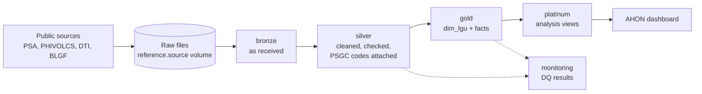

# AHON-Pipeline

Project AHON is a data-driven disaster and hazard monitoring platform designed to provide actionable insights that strengthen disaster preparedness and decision-making.

Earthquake data in the Philippines is spread across agencies, formats and place names, so local leaders rarely see the full picture. AHON combines these sources, matched to one code per city or municipality, to show where earthquake risk is high, where preparedness falls short, and what to strengthen first. The main product is the AHON dashboard; this repository holds the pipeline that feeds it.

## Questions AHON answers

1. What is each LGU's earthquake risk level?
2. How prepared is each LGU relative to its risk?
3. Which LGUs have high risk but low preparedness?
4. Which areas of preparedness should these LGUs strengthen first?

Users, stakeholders and expected impact are in the [problem statement](docs/project/problem-statement.md). How the measures are calculated is in the [analytics method](docs/architecture/analytics-method.md).

## Data sources

| Dataset | Publisher | Used for |
| --- | --- | --- |
| PSGC | PSA | The shared LGU codes and names (`gold.dim_lgu`) |
| PSA Population | PSA (census, from the PSGC API) | Exposure: residents per city and municipality |
| Earthquake listings | PHIVOLCS | Hazard: earthquake counts, magnitude and depth |
| Cities and Municipalities Competitiveness Index (CMCI) | DTI | Preparedness: resiliency indicators |
| LDRRMF utilization | BLGF | Preparedness: disaster fund budget and spending |

Details, periods and what is out of scope: [sources](docs/data/sources.md).

## How it works



A batch pipeline on Databricks, defined as a Databricks Asset Bundle. Raw files land unchanged in a Unity Catalog volume, then move through bronze, silver, gold and platinum. Every table is linked by the 10-digit PSGC code, and analysis is done per city and municipality. Each build checks its output before writing and records the result in `monitoring.dq_result`.

More: [architecture overview](docs/architecture/overview.md), [data model](docs/architecture/data-model.md), [data quality](docs/data-quality/README.md).

## Getting started

1. Set up your tools, Databricks login and bundle settings: [setup](docs/getting-started/setup.md).
2. Deploy and run the job `ahon_pipeline`: [runbook](docs/operations/runbook.md).

```text
databricks bundle validate --strict -t dev --profile <profile>
databricks bundle deploy -t dev --profile <profile>
databricks bundle run ahon_pipeline -t dev --profile <profile>
```

Credentials (Databricks login, PSA token) and your bundle settings stay on your machine or in Databricks secrets, never in the repository.

## Documentation

| Folder | What is in it |
| --- | --- |
| [docs/project](docs/project/) | Problem statement, assumptions and limitations, ownership |
| [docs/data](docs/data/) | Sources, a data profile per source, and a data dictionary page per table |
| [docs/architecture](docs/architecture/) | Overview, data model, source to target, analytics method, naming standard |
| [docs/data-quality](docs/data-quality/) | How checks work, the DQ gates and the results table |
| [docs/operations](docs/operations/) | Runbook: running, rerunning and recovering the pipeline |
| [docs/getting-started](docs/getting-started/) | Setup for new team members |
| [docs/decisions](docs/decisions/) | Decision records, one per decision |
| [docs/archive](docs/archive/) | Older pages kept for reference |

## Repository structure

```
AHON-Pipeline/
├── README.md                    # this file
├── CONTRIBUTING.md              # how the team works: branches, PRs, CI checks, review
├── databricks.yml               # Asset Bundle: dev and prod targets, variables, includes resources/
├── config/
│   └── variable-overrides.example.json   # template for your private bundle settings
├── .github/
│   ├── workflows/               # CI checks and the reviewer auto-assign
│   ├── ISSUE_TEMPLATE/          # issue templates
│   └── pull_request_template.md # PR template
├── resources/
│   ├── jobs/                    # ahon_pipeline, catalog_setup, data_quality (dev only)
│   └── cmci_indicators.csv      # the selected CMCI indicators
├── src/
│   └── sql/                     # all pipeline code, SQL and Python together
│       ├── 00_setup/            # catalog, schemas, volume and monitoring tables
│       ├── datasets/            # one folder per source dataset
│       │   └── <dataset>/
│       │       ├── extract/     # pulls data from the source and writes raw files
│       │       ├── bronze/      # loads raw files into bronze.<dataset>
│       │       └── silver/      # cleans into silver.<dataset>_clean (+ _reject)
│       ├── gold/                # dimensions and facts, combining datasets
│       ├── platinum/            # analysis views built from gold
│       ├── monitoring/          # DQ gates per dataset
│       └── common/              # shared Python: runners, quality checks, DQ gate
├── notebooks/
│   └── exploration/             # experiments only; jobs never run these
├── tests/                       # unit and job contract tests, mirroring src/sql/
└── docs/                        # see Documentation above
```

### Where things go

- **Code:** each dataset has its own folder under `src/sql/datasets/`, named after the dataset, with `bronze/` and `silver/` folders (and `extract/` when it pulls from the source). Code that is shared or combines datasets goes in the shared folders (`gold/`, `platinum/`, `common/`).
- **Source files:** file-based sources are uploaded to the team's Hugging Face dataset repository and copied unchanged into the `<catalog>.reference.<source_volume>` volume by the dataset's `extract/` code, in one folder per dataset and batch. Bronze code reads from the volume only ([decision 0004](docs/decisions/0004-source-file-landing-hugging-face.md)).
- **Jobs:** tasks are defined in `resources/jobs/`. Jobs run `.sql` and `.py` files from `src/sql/`, never notebooks.
- **Setup scripts:** files in `src/sql/00_setup/` have number prefixes because they run in order.
- **Tests:** in `tests/`, in the same layout as `src/sql/`.
- **Docs:** add or update the table's [data dictionary](docs/data/data-dictionary/README.md) page in the same PR that adds or changes the table. Record design choices in `docs/decisions/`.

Names follow the [naming standard](docs/architecture/naming-standard.md).

## Team

Yanna, Maki, Jessy, Crystal and Crizza. Who owns which dataset: [ownership](docs/project/ownership.md). How to contribute: [CONTRIBUTING](CONTRIBUTING.md).
