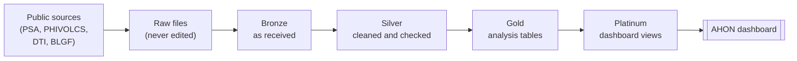

# AHON-Pipeline

Project AHON is a data-driven disaster and hazard monitoring platform designed to provide actionable insights that strengthen disaster preparedness and decision-making.

Earthquake data in the Philippines is spread across agencies, formats and place names, so local leaders rarely see the full picture. AHON aims to combine these sources with reviewed city and municipality identities to show where earthquake risk is high, where preparedness falls short, and what to strengthen first. The main product is the AHON dashboard; this repository holds the pipeline that feeds it.

## Implementation status

The current pipeline publishes geographic references, reported census population, CMCI indicator measurements and coverage, disaster-fund components, and earthquake observation summaries. Every run records its data quality results, which the AHON Data Quality Monitoring dashboard shows. The AHON Pipeline Runs dashboard shows each job run and its tasks.

The analytical questions below describe the project's intended outcomes. Composite LGU risk, preparedness and vulnerability rankings are not yet implemented as approved pipeline outputs. Earthquake locality candidates are reported, but observations are not assigned to LGUs as exposure or impact.

The dashboard remains under development. See [dashboard status](docs/insights/dashboard.md).

## Questions AHON aims to answer

1. What is each LGU's earthquake risk level?
2. How prepared is each LGU relative to its risk?
3. Which LGUs have high risk but low preparedness?
4. Which areas of preparedness should these LGUs strengthen first?

Users, stakeholders and expected impact are in the [problem statement](docs/project/problem-statement.md). How the measures are calculated is in the [analytics method](docs/architecture/analytics-method.md).

## Data sources

| Dataset | Publisher | Used for |
| --- | --- | --- |
| Philippine Standard Geographic Code (PSGC) | Philippine Statistics Authority (PSA) | The shared LGU codes and names (`gold.dim_lgu`) |
| PSA Population | PSA (census, from the PSGC API) | Exposure: residents per city and municipality |
| Earthquake listings | Philippine Institute of Volcanology and Seismology (PHIVOLCS) | Hazard: earthquake counts, magnitude and depth |
| Cities and Municipalities Competitiveness Index (CMCI) | Department of Trade and Industry (DTI) | Preparedness: resiliency indicators |
| Local Disaster Risk Reduction and Management Fund (LDRRMF) utilization | Bureau of Local Government Finance (BLGF) | Preparedness: disaster fund budget and spending |

Details, periods and what is out of scope: [sources](docs/data/sources.md).

## How it works



AHON is a batch pipeline on Databricks. Each source is downloaded into a folder of raw files, then refined in four layers: **bronze** keeps the data as received, **silver** cleans and types source data, preserves quality findings, and attaches reviewed PSGC identities where supported. Earthquake observations retain locality candidates with geographic assignment withheld; unmatched funding reports retain a NULL PSGC code. **Gold** builds the tables used for analysis, and **platinum** prepares the views the dashboard reads. Build checks record quality results. Earlier successful writes are not rolled back when a later check fails.

### Data quality

The pipeline runs 12 layer-gate tasks after their corresponding builds. Census and OpenSTAT population have independent silver and gold gates. Blocking results stop dependent tasks; warning results remain visible. Gate and build checks share `monitoring.dq_result`. Earlier writes are not rolled back.

The AHON Data Quality Monitoring dashboard (`resources/dashboards/ahon_data_quality.lvdash.json`) is deployed with the bundle and shows what passed, what is broken and whether anything stopped the run. See [data quality](docs/data-quality/README.md). The AHON Pipeline Runs dashboard (`resources/dashboards/ahon_pipeline_runs.lvdash.json`) shows when each job ran, how long it took, and which tasks succeeded, failed or were skipped. See [pipeline runs](docs/operations/pipeline-runs.md).

New to the acronyms? See the [glossary](docs/architecture/glossary.md).

Layer-by-layer diagram: [architecture overview](docs/architecture/overview.md), [data model](docs/architecture/data-model.md), [data quality](docs/data-quality/README.md).

## Getting started

New to the repository? Read in this order:

1. This README, and the [glossary](docs/architecture/glossary.md) for acronyms.
2. [Architecture overview](docs/architecture/overview.md): how data moves through the layers.
3. [Setup](docs/getting-started/setup.md): tools, Databricks access, settings, your own PSGC token from PSA, and your first run.
4. [Runbook](docs/operations/runbook.md): running one dataset, rerunning and fixing a failed run.
5. [CONTRIBUTING](CONTRIBUTING.md): branches, pull requests and CI checks.

Once set up, the commands are:

```text
databricks bundle validate --strict -t dev --profile <profile>
databricks bundle deploy -t dev --profile <profile>
databricks bundle run ahon_pipeline -t dev --profile <profile>
```

Before the first run you need your own PSGC API token from PSA ([how to request and store it](docs/getting-started/setup.md#4-get-and-store-your-psgc-token)). Credentials (Databricks login, PSA token) and your bundle settings stay on your machine or in Databricks secrets, never in the repository.

## Documentation

| Folder | What is in it |
| --- | --- |
| [docs/architecture/glossary.md](docs/architecture/glossary.md) | Acronyms and terms |
| [docs/project](docs/project/) | Problem statement, assumptions and limitations, ownership |
| [docs/data](docs/data/) | Sources, a data profile per source, and a data dictionary page per table |
| [docs/architecture](docs/architecture/) | Overview, data model, source to target, analytics method, naming standard |
| [docs/data-quality](docs/data-quality/) | How checks work, the DQ gates, the results table and the DQ dashboard |
| [docs/operations](docs/operations/) | Runbook (running, rerunning and recovering the pipeline) and pipeline run records |
| [docs/getting-started](docs/getting-started/) | Setup for new team members |
| [docs/insights](docs/insights/) | Dashboard status and verified findings |
| [docs/decisions](docs/decisions/) | Decision records, one per decision |
| [docs/archive](docs/archive/) | Older pages kept for reference |

## Repository structure

```
AHON-Pipeline/
├── README.md                    # this file
├── CONTRIBUTING.md              # how the team works: branches, PRs, CI checks, review
├── databricks.yml               # Asset Bundle: dev and prod targets, variables, includes resources/
├── config/
│   └── variable-overrides.example.json   # template for your private bundle settings
├── .github/
│   ├── workflows/               # CI checks and the reviewer auto-assign
│   ├── ISSUE_TEMPLATE/          # issue templates
│   └── pull_request_template.md # PR template
├── resources/
│   ├── jobs/                    # ahon_pipeline, catalog_setup, data_quality (dev only)
│   ├── dashboards/              # AHON Data Quality Monitoring and AHON Pipeline Runs dashboards
│   └── cmci_indicators.csv      # the selected CMCI indicators
├── src/
│   └── sql/                     # all pipeline code, SQL and Python together
│       ├── 00_setup/            # catalog, schemas, volume, monitoring table and DQ dashboard views
│       ├── datasets/            # one folder per source dataset
│       │   └── <dataset>/
│       │       ├── extract/     # pulls data from the source and writes raw files
│       │       ├── bronze/      # loads raw files into bronze.<dataset>
│       │       └── silver/      # cleans into silver.<dataset>_clean (+ _reject)
│       ├── gold/                # dimensions and facts, combining datasets
│       ├── platinum/            # analysis views built from gold
│       ├── monitoring/          # DQ gates per dataset and the run log views
│       └── common/              # shared Python: runners, quality checks, DQ gate
├── notebooks/
│   └── exploration/             # experiments only; jobs never run these
├── tests/                       # unit and job contract tests, mirroring src/sql/
└── docs/                        # see Documentation above
```

### Where things go

- **Code:** each dataset has its own folder under `src/sql/datasets/`, named after the dataset, with `bronze/` and `silver/` folders (and `extract/` when it pulls from the source). Code that is shared or combines datasets goes in the shared folders (`gold/`, `platinum/`, `common/`).
- **Source files:** file-based sources are uploaded to the team's Hugging Face dataset repository and copied unchanged into the `<catalog>.reference.<source_volume>` volume by the dataset's `extract/` code, in one folder per dataset and batch. Bronze code reads from the volume only ([decision 0004](docs/decisions/0004-source-file-landing-hugging-face.md)).
- **Jobs and dashboards:** tasks are defined in `resources/jobs/`, dashboards in `resources/dashboards/`. Jobs run `.sql` and `.py` files from `src/sql/`, never notebooks.
- **Setup scripts:** files in `src/sql/00_setup/` have number prefixes because they run in order.
- **Tests:** in `tests/`, in the same layout as `src/sql/`.
- **Docs:** add or update the table's [data dictionary](docs/data/data-dictionary/README.md) page in the same PR that adds or changes the table. Record design choices in `docs/decisions/`.

Names follow the [naming standard](docs/architecture/naming-standard.md).

## Team

Yanna, Maki, Jessy, Crystal and Crizza. Who owns which dataset: [ownership](docs/project/ownership.md).

How to contribute: [CONTRIBUTING](CONTRIBUTING.md).

## Dashboard export

The [dashboard export](resources/dashboard/Project%20AHON%20LGU%20Command%20Center%20for%20DRRM%20Plans.lvdash.json) preserves the latest uploaded PR #105 pages, widgets and layout with targeted query fixes. See [dashboard status and import prerequisites](docs/insights/dashboard.md): missing funding/CMCI tables, boundary geometry and unapproved scoring methods still limit runtime availability.
