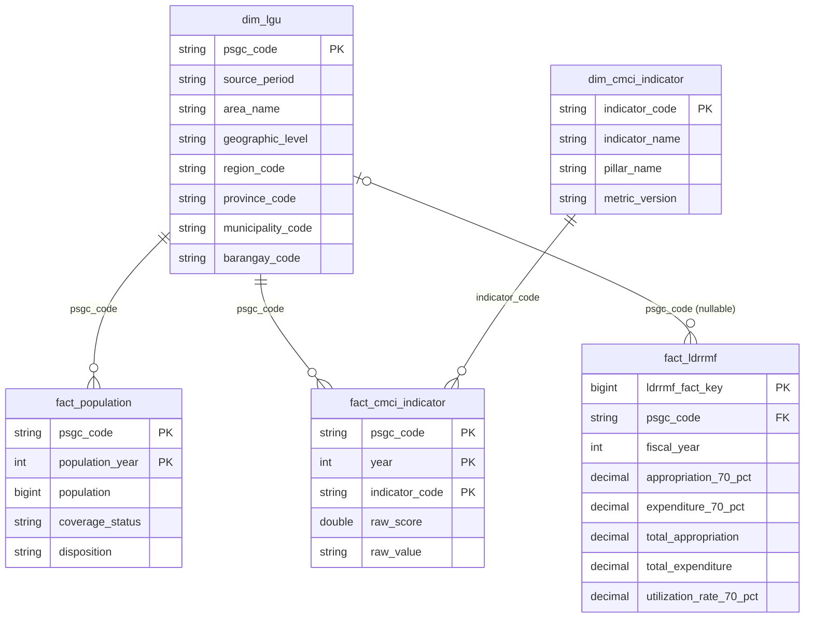

# Analytical data model

The gold layer is a star around one dimension, `gold.dim_lgu`. Every fact links to it by the 10-digit string `psgc_code`. Platinum views sit on top of the facts and keep cities and municipalities only.

## Diagram

Earthquake observations have no gold table and no relationship to `dim_lgu` yet (see below).

## Tables, grains and keys

`gold.dim_lgu` contains one current PSGC entity per string `psgc_code`, with its selected `source_period`, names, geographic level and standardized hierarchy codes. Codes, period and level are checked before facts reference it.

| Table | Grain | Key | Meaning |
| --- | --- | --- | --- |
| [`gold.dim_lgu`](../data/data-dictionary/dim_lgu.md) | One PSGC entity in the selected snapshot (all levels, region to barangay) | `psgc_code` | Shared LGU dimension; analysis uses `CITY` and `MUN` rows only |
| [`gold.fact_population`](../data/data-dictionary/fact_population.md) | City/municipality × census year | `(psgc_code, population_year)` | Direct CITY/MUN source measurement; missing records/values remain NULL; full LGU/year grid |
| [`gold.fact_cmci_indicator`](../data/data-dictionary/fact_cmci_indicator.md) | City/municipality × CMCI year × indicator | `(psgc_code, year, indicator_code)` | Source indicator measurement; missing or invalid latest values are NULL; reviewed source identity retained |
| [`gold.dim_cmci_indicator`](../data/data-dictionary/dim_cmci_indicator.md) | Selected CMCI indicator | `indicator_code` | 35-code label/pillar metadata; `metric_version = selected_35_v1` identifies the selected subset |
| [`gold.fact_ldrrmf`](../data/data-dictionary/fact_ldrrmf.md) | Original BLGF reporting entity × fiscal year | `ldrrmf_fact_key` from `(fiscal_year, region, province, lgu_name, lgu_type)`; `(psgc_code, fiscal_year)` unique where matched | Separate 70%/30% amounts and totals in pesos; utilization ratios; PSGC match status |

| Platinum view | Built from | Grain |
| --- | --- | --- |
| [`platinum.population_components`](../data/data-dictionary/population_components.md) | `fact_population` | City/municipality × census year |
| [`platinum.cmci_pillar_coverage`](../data/data-dictionary/cmci_pillar_coverage.md) | `fact_cmci_indicator`, `dim_cmci_indicator` | City/municipality × year × pillar |
| [`platinum.funding_components`](../data/data-dictionary/funding_components.md) | `fact_ldrrmf`, `dim_lgu` | City/municipality report × fiscal year |
| [`platinum.earthquake_observation_summary`](../data/data-dictionary/earthquake_observation_summary.md) | `silver.philvolcs_earthquake_observation_clean` | Listing year × month |

## Earthquakes

Earthquake tables contain observations, not established deduplicated events. Textual candidates are arrays in silver and never fact relationships to LGUs. Event-level gold is withheld until identity, duplicate and correction policy are approved ([decision 0009](../decisions/0009-earthquake-observations-and-locality-candidates.md)).

## Join rules

- Join facts to `dim_lgu` on `psgc_code`, and only at aligned geographic grains: cities and municipalities (`CITY`, `MUN`). The analysis grain is set in [decision 0012](../decisions/0012-city-municipality-analysis-grain.md).
- Use explicitly selected reference periods. Every fact carries the PSGC `source_period` it was matched with, and it must equal `dim_lgu.source_period`.
- A 2024 census is not annual exposure for every CMCI or fiscal year. Pick the year to compare on purpose.
- Historical fiscal entities can differ from the current PSGC geography; preserve unmatched codes and source names. Unmatched LDRRMF rows have `psgc_code` NULL and do not join.
- Never sum provincial funding with municipal funds to infer a common LGU resource total. Province reports are excluded from `funding_components`.
- Province totals of population are the sum of their cities and municipalities.
- Never join on names. LGU names repeat across provinces.
- Use the [analytics method](analytics-method.md) for how these facts combine into risk and preparedness measures, with their coverage fields.
