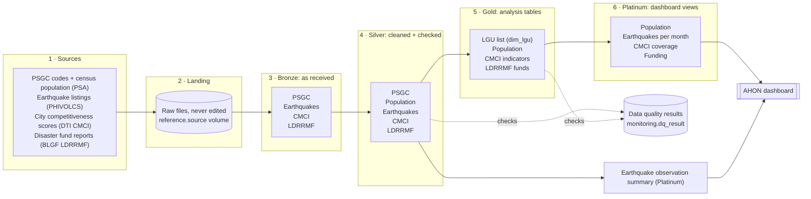

# Architecture overview

Project AHON is a batch pipeline on Databricks. It lands public government data in a Unity Catalog volume, refines it through bronze, silver, gold and platinum layers, and serves city and municipality tables to the AHON dashboard. The 10-digit PSGC code is the conformed LGU identifier for supported analytical joins. Some funding reports remain unmatched. Earthquake observations contain locality candidates but no assigned PSGC identity.

## Diagram

How to read it: each box is one layer, and each item inside is one dataset at that layer. Population has no bronze table of its own (it arrives inside the PSGC data), and earthquakes have no gold table yet. The exact table names are in the table below and in [source to target](source-to-target.md). Acronyms are explained in the [glossary](glossary.md).

## Data flow by dataset

| Dataset | Bronze | Silver | Gold | Platinum |
| --- | --- | --- | --- | --- |
| PSGC | `psa_psgc` | `psa_psgc_clean` | `dim_lgu` | |
| PSA Population | (in `psa_psgc`) | `psgc_city_population_clean` | `fact_population` | `population_components` |
| PHIVOLCS earthquakes | `philvolcs_earthquake_observation` | `philvolcs_earthquake_observation_clean` | none yet | `earthquake_observation_summary` |
| CMCI | `cmci_raw_indicator_batch_html` | `cmci_indicator_clean` (uses `reference.cmci_lgu_map`) | `fact_cmci_indicator`, `dim_cmci_indicator` | `cmci_pillar_coverage` |
| BLGF LDRRMF | `blgf_ldrrmf_annual_lgu` | `blgf_ldrrmf_annual_lgu_clean` (uses `reference.blgf_ldrrmf_lgu_map`) | `fact_ldrrmf` | `funding_components` |

`dim_lgu` and PSGC Silver provide references for dependent branches. Earthquakes use PSGC Silver for candidates. Independent extracts can run after setup. Each dataset's table pages are in the [data dictionary](../data/data-dictionary/README.md); script-level mapping is in [source-to-target](source-to-target.md).

## Ingestion

- **API and web sources** (PSGC, PHIVOLCS, CMCI) are pulled by each dataset's `extract/` script. The PSGC API needs a PSA-issued token, read from a Databricks secret.
- **File sources** (BLGF LDRRMF workbooks) are downloaded from BLGF, uploaded to the project's Hugging Face dataset, and read from a pinned commit ([decision 0004](../decisions/0004-source-file-landing-hugging-face.md)).
- Every extract writes one batch folder per run under `/Volumes/<catalog>/reference/<source_volume>/<dataset>/<batch_id>/`, with a `_SUCCESS.json` marker recording each file's name, SHA-256 and row count. Bronze reads only completed batches, and a completed batch is never changed. A correction is a new batch.

## Processing

| Layer | What happens |
| --- | --- |
| Bronze | Source values kept as received (mostly text), plus provenance: `_source_name`, `_source_ref`, `_source_digest`, `_ingested_at`, `_batch_id`, `_row_hash`, `_observation_id`. Loads stop on a changed header, row count or checksum. |
| Silver | Types, trims and validates values; derives fiscal year, hierarchy codes and similar fields; attaches PSGC codes through reviewed reference maps. Bad rows are flagged with `has_dq_issues` or copied to a `_reject` table; nothing is silently dropped. |
| Gold | Conformed dimension (`dim_lgu`) and facts keyed by `psgc_code`, with fixed grains such as city/municipality × census year or LGU × fiscal year. |
| Platinum | Population and funding component views, the persisted CMCI coverage table, and a monthly earthquake observation summary without LGU assignment. |

Bronze preserves observations using each dataset's observation identity. Silver and Gold use their documented observation or business keys. Writes do not delete records merely because they disappear from a later delivery. Updates follow each writer's change conditions; the pipeline does not provide one transaction spanning all tables or tasks. Schema changes require review. The analysis grain is the city or municipality ([decision 0017](../decisions/0017-city-municipality-analysis-grain.md)).

## Storage

One Unity Catalog catalog per environment (for example a personal dev catalog), with these schemas:

| Schema | Holds |
| --- | --- |
| `reference` | The `source` volume with raw files, and the reviewed LGU name-to-PSGC maps |
| `bronze`, `silver`, `gold`, `platinum` | Delta tables and views for each layer |
| `monitoring` | Data quality results |

Names follow the [naming standard](naming-standard.md).

## Serving

The available Gold and Platinum components support the developing dashboard. Supported LGU joins use `psgc_code` through `dim_lgu`; earthquake summaries have no assigned LGU key. The main bundle contains no dashboard resource or publication schedule. [Analytics method](analytics-method.md) distinguishes proposed scores from implemented outputs; see [dashboard status](../insights/dashboard.md).

## Orchestration

The pipeline is a Databricks Asset Bundle (`databricks.yml`, jobs in `resources/jobs/`, [decision 0015](../decisions/0015-reconciled-source-contracts.md)):

| Job | Purpose |
| --- | --- |
| `catalog_setup` | Creates the catalog (if permitted), the six schemas, the `reference.source` volume and `monitoring.dq_result` |
| `ahon_pipeline` | One task per dataset step (extract, bronze, silver, mapping, gold, platinum) |
| `data_quality` | Development-only verification against test fixtures |

Tasks run on serverless compute with explicit timeout, retry and one concurrent run. Independent sources depend only on setup, so one failed source does not block another; gold waits for its silver and `dim_lgu`. There is no schedule; runs are started by hand. Bundle variables (catalog, source volume, PSGC snapshot, years, secrets) are set per developer in a git-ignored overrides file. See [setup](../getting-started/setup.md) and the [runbook](../operations/runbook.md).

## Data quality

Build checks persist results in `monitoring.dq_result`. A blocking check prevents the associated downstream write where evaluated before that write; earlier successful statements and upstream tasks are not rolled back. This integration candidate runs twelve layer-gate tasks using the shared eight-column result contract. Census and OpenSTAT gates are independent. Unbuilt-table placeholders remain inactive. See [data quality](../data-quality/README.md) and [DQ gates](../data-quality/dq-gates.md).

## Why these choices

| Choice | Why |
| --- | --- |
| Databricks with Unity Catalog | One place for files, tables, jobs, permissions and the dashboard |
| Medallion layers | Raw data stays untouched in bronze, so any later layer can be rebuilt and every value traced back to its source file |
| PSGC code as the only join key | LGU names repeat and are spelled differently across agencies; codes do not |
| Reviewed reference maps for names | Name matching is reviewed once and stored, instead of guessed at join time |
| Hugging Face for source files | Versioned, shared copies of files that have no API, pinned to a commit |
| Databricks Asset Bundle | Jobs, tasks and parameters live in the repository and deploy the same way for every developer |
| Merge without deletes | Absent keys are retained; Delta history and recorded lineage support investigation, subject to retention |
| Great Expectations | Shared, recorded data quality rules on Spark tables |

## Outside the analytical path

The job also runs PSA OpenSTAT urban population (`fact_population_total`) outside the primary intended dashboard path. It is retained for cross-checking; see [sources](../data/sources.md).
