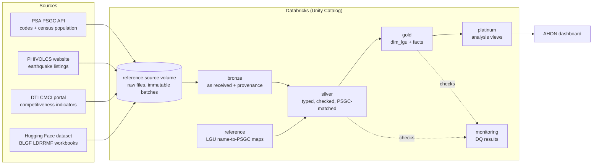

# Architecture overview

Project AHON is a batch pipeline on Databricks. It lands public government data in a Unity Catalog volume, refines it through bronze, silver, gold and platinum layers, and serves city and municipality tables to the AHON dashboard. Every dataset is linked by one key, the 10-digit PSGC code.

## Diagram

## Data flow by dataset

| Dataset | Bronze | Silver | Gold | Platinum |
| --- | --- | --- | --- | --- |
| PSGC | `psa_psgc` | `psa_psgc_clean` | `dim_lgu` | |
| PSA Population | (in `psa_psgc`) | `psgc_city_population_clean` | `fact_population` | `population_components` |
| PHIVOLCS earthquakes | `philvolcs_earthquake_observation` | `philvolcs_earthquake_observation_clean` | none yet | `earthquake_observation_summary` |
| CMCI | `cmci_raw_indicator_batch_html` | `cmci_indicator_clean` (uses `reference.cmci_lgu_map`) | `fact_cmci_indicator`, `dim_cmci_indicator` | `cmci_pillar_coverage` |
| BLGF LDRRMF | `blgf_ldrrmf_annual_lgu` | `blgf_ldrrmf_annual_lgu_clean` (uses `reference.blgf_ldrrmf_lgu_map`) | `fact_ldrrmf` | `funding_components` |

PSGC runs first: `dim_lgu` and the PSGC silver table are the reference every other dataset matches against. Each dataset's table pages are in the [data dictionary](../data/data-dictionary/README.md); script-level mapping is in [source-to-target](source-to-target.md).

## Ingestion

- **API and web sources** (PSGC, PHIVOLCS, CMCI) are pulled by each dataset's `extract/` script. The PSGC API needs a PSA-issued token, read from a Databricks secret.
- **File sources** (BLGF LDRRMF workbooks) are downloaded from BLGF, uploaded to the project's Hugging Face dataset, and read from a pinned commit ([decision 0004](../decisions/0004-source-file-landing-hugging-face.md)).
- Every extract writes one batch folder per run under `/Volumes/<catalog>/reference/<source_volume>/<dataset>/<batch_id>/`, with a `_SUCCESS.json` marker recording each file's name, SHA-256 and row count. Bronze reads only completed batches, and a completed batch is never changed. A correction is a new batch.

## Processing

| Layer | What happens |
| --- | --- |
| Bronze | Source values kept as received (mostly text), plus provenance: `_source_name`, `_source_ref`, `_source_digest`, `_ingested_at`, `_batch_id`, `_row_hash`, `_observation_id`. Loads stop on a changed header, row count or checksum. |
| Silver | Types, trims and validates values; derives fiscal year, hierarchy codes and similar fields; attaches PSGC codes through reviewed reference maps. Bad rows are flagged with `has_dq_issues` or copied to a `_reject` table; nothing is silently dropped. |
| Gold | Conformed dimension (`dim_lgu`) and facts keyed by `psgc_code`, with fixed grains such as city/municipality × census year or LGU × fiscal year. |
| Platinum | Views for analysis and the dashboard, limited to cities and municipalities. |

All layers merge on business keys. Absent rows are not deleted, an older delivery cannot overwrite a newer correction, and a schema change stops the build for review. The analysis grain is the city or municipality ([decision 0012](../decisions/0012-city-municipality-analysis-grain.md)).

## Storage

One Unity Catalog catalog per environment (for example a personal dev catalog), with these schemas:

| Schema | Holds |
| --- | --- |
| `reference` | The `source` volume with raw files, and the reviewed LGU name-to-PSGC maps |
| `bronze`, `silver`, `gold`, `platinum` | Delta tables and views for each layer |
| `monitoring` | Data quality results |

Names follow the [naming standard](naming-standard.md).

## Serving

The AHON dashboard reads the gold and platinum tables. It joins every dataset on `psgc_code` through `dim_lgu`. How the dashboard turns these into risk and preparedness measures is in [analytics method](analytics-method.md).

## Orchestration

The pipeline is a Databricks Asset Bundle (`databricks.yml`, jobs in `resources/jobs/`, [decision 0007](../decisions/0007-DAB-and-jobs.md)):

| Job | Purpose |
| --- | --- |
| `catalog_setup` | Creates the six schemas in the catalog |
| `ahon_pipeline` | One task per dataset step (extract, bronze, silver, mapping, gold, platinum) |
| `data_quality` | Development-only verification against test fixtures |

Tasks run on serverless compute with explicit timeout, retry and one concurrent run. Independent sources depend only on setup, so one failed source does not block another; gold waits for its silver and `dim_lgu`. There is no schedule; runs are started by hand. Bundle variables (catalog, source volume, PSGC snapshot, years, secrets) are set per developer in a git-ignored overrides file. See [setup](../getting-started/setup.md) and the [runbook](../operations/runbook.md).

## Data quality

Checks run inside every build. Stop rules fail the task before the target table is written, so dependent tasks do not run on bad data. Flag and warning rules keep the rows and record a count. Results are written to the `monitoring` schema. Great Expectations gates between layers record rule results in one DQ results table. See [data quality](../operations/monitoring/data-quality.md) and [DQ gates](../operations/monitoring/dq-gates.md).

## Why these choices

| Choice | Why |
| --- | --- |
| Databricks with Unity Catalog | One place for files, tables, jobs, permissions and the dashboard |
| Medallion layers | Raw data stays untouched in bronze, so any later layer can be rebuilt and every value traced back to its source file |
| PSGC code as the only join key | LGU names repeat and are spelled differently across agencies; codes do not |
| Reviewed reference maps for names | Name matching is reviewed once and stored, instead of guessed at join time |
| Hugging Face for source files | Versioned, shared copies of files that have no API, pinned to a commit |
| Databricks Asset Bundle | Jobs, tasks and parameters live in the repository and deploy the same way for every developer |
| Merge without deletes | Reruns are safe, and corrections never erase history |
| Great Expectations | Shared, recorded data quality rules on Spark tables |

## Outside the analytical path

The job also runs two sources that the dashboard does not use: OpenStreetMap features (bronze and silver only) and PSA OpenSTAT urban population (`fact_population_total`). They are kept for later use and cross-checking; see [sources](../data/sources.md).
