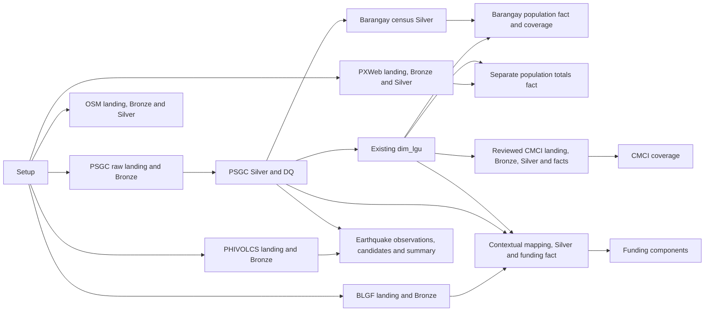

# Pipeline architecture

The executable pipeline is a batch workflow defined in `resources/jobs/ahon_job.yml`, using existing `src/sql/` entry points. See the [source-to-target inventory](source-to-target.md) for source periods, keys, dependencies, PR decisions and blockers.

Raw landing batches are immutable. Bronze records retain source columns and row/file/run provenance. Silver types, validates and disposition records; deterministic selection preserves raw predecessors. Gold owns explicit fact/dimension grains. Platinum holds query-specific coverage and component views. GX evaluates full-input rule metrics computed by Spark. DQ results and GX JSON evidence are recorded in `monitoring.dq_result` before a blocking error stops dependent tasks.

The dimension is a current snapshot, not a historical SCD. Changing its selected period is guarded. No absence-based deletion, automatic schema replacement or name-only geographic assignment is part of the supported workflow. Schema differences require separate review; fresh development catalogs permit safe verification.

Schedules are absent. Serverless STANDARD runs bounded batch tasks with explicit concurrency, timeout and retry inputs; use one concurrent writer. The staged fixture verification job is development-only and has no automatic retry; use a fresh catalog after a failed attempt. Production requires an explicit run identity. Independent sources depend only on setup; a failed source does not gate another source's ingestion. Downstream Gold waits for its reference and Silver checks. See the [runbook](../operations/runbook.md).
