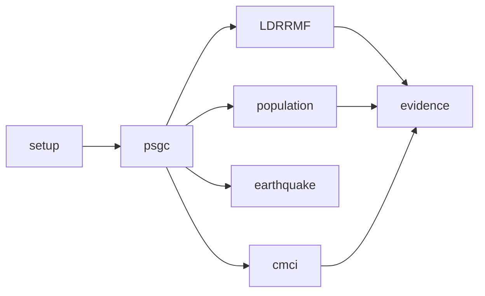

# Architecture

The bundle creates setup, five dataset jobs, combined evidence, cross-job orchestration and a dedicated synthetic integration job. Serverless Python tasks execute scripts through a repository launcher; SQL files execute sequentially through run_sql.py.

Each dataset runs extraction → Bronze → Silver → supported Gold/Platinum with successful dependencies. Earthquake ends in Silver observations and uncertain locality candidates, without an inferred event or exposure join. Dataset final accounting runs after the terminal task regardless of outcome and fails when it was unsuccessful. Independent jobs can run directly if another dataset is blocked. The evidence job can report missing component tables; the parent waits for its declared input jobs.

Setup creates the selected catalog if absent, then schemas, source volume and monitoring tables; catalog creation requires appropriate privileges. It does not provision secrets or destructive schema changes. Integration verification uses separately named synthetic catalogs. Delta transactions apply per table, not across a job. Consumers use completed checks/run state before releasing outputs.

Reference snapshot Q2_2024 is explicit. The shared dimension has one row per PSGC code at one selected snapshot across all levels. Facts restrict administrative level before joining. Changing the dimension snapshot requires a reviewed migration. Historical facts mapped to Q2_2024 do not claim historically exact boundaries.

See [source-to-target](source-to-target.md), [data model](data-model.md), [metrics](metrics.md), [runbook](../operations/runbook.md).
